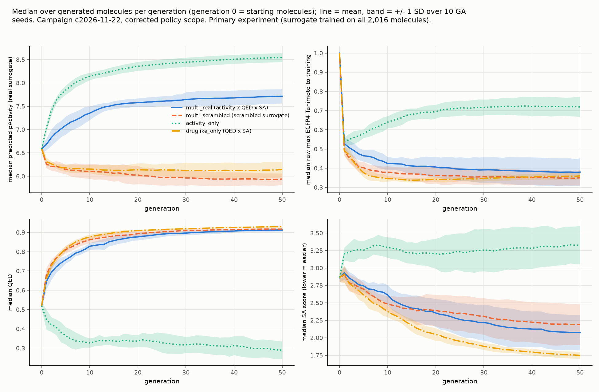

# Does a surrogate-driven molecule optimizer improve the target, or exploit the surrogate?

A methodological case study on human CDK2 (cyclin-dependent kinase 2).

**Question.** When a genetic algorithm (GA) designs molecules against a machine-learned activity model under drug-likeness constraints, does the objective rise because the molecules get better, or because the optimizer finds where the model's extrapolation error is largest?

**What this is not.** It does not show that any generated molecule is active against CDK2, and it did not measure the surrogate's error on generated molecules. It is a study of how optimization curves behave, with the controls needed to interpret them. Problems found in an independent review of the first campaign are tracked in [`docs/known_issues.md`](docs/known_issues.md); they are fixed in code, and a second campaign (`c2026-11-22`, 10 seeds) repeats the experiment with the fixes. Its results are the ones reported below.



*Campaign c2026-11-22. Median per generation over 10 GA seeds (band = ±1 SD). Predicted activity rises for the activity-driven arms, but the rise is the surrogate's own output: a GA driven by a label-scrambled model and a drug-likeness-only GA are the controls. More figures with captions and limitations: [`docs/figure_index.md`](docs/figure_index.md).*

## Approach

| Component | Choice |
|---|---|
| Data | ChEMBL CHEMBL301 (human CDK2) IC50 records, cached download of 5,367 rows, curated to 2,016 standardized structures (exact `=` records only, mutant assays removed, median pActivity per structure) |
| Surrogate | ECFP4 (radius 2, 2048 bits) + random forest (300 trees); random, scaffold and primary-document splits, 10 seeds each, with label-scrambled, mean and size-only controls |
| Optimizer | Graph-based GA (population 100, 50 generations, 20-39 heavy atoms). Four arms: `multi_real` (activity × QED × SA), `multi_scrambled` (same, scrambled surrogate), `activity_only`, `druglike_only` (QED × SA). Ten seeds per arm, each with its own scrambled-label permutation |
| Extensions | Held-out surrogates (without 204 top-decile actives; without 9 scaffold families), five scaffold-split surrogates, constrained runs with a hard similarity floor (0.4-0.7) |
| Orthogonal check | AutoDock Vina into PDB 4KD1, native-ligand redocking, PoseBusters (22 checks), hinge-contact distance |
| Preparation policy | Candidates are standardized like the training data, closed-shell only, deduplicated (`corrected`). The first campaign also ran `legacy` (candidates scored as edited); the comparison bundled three changes and the second campaign dropped it |
| Discipline | Analysis plan frozen before each campaign's runs ([`c2026-10-03`](campaigns/c2026-10-03/plan/), [`c2026-11-22`](campaigns/c2026-11-22/plan/)), amendments appended, SHA-256 manifests for every stage output, a ledger of every run, and a leakage and artifact audit |

The plan was written after the project's earlier exploratory work, with those results known, so it is not a plan written before all exploration.

## Project status

| Campaign | State | Design |
|---|---|---|
| `c2026-10-03` | Complete, frozen | Two preparation policies (`legacy`, `corrected`), 5 GA seeds per arm, one scrambled-label permutation. Reviewed afterwards; its problems are listed in [`docs/known_issues.md`](docs/known_issues.md) |
| `c2026-11-22` | **Complete** (38 of 38 stages, run 2026-11-22 to 2026-11-23 on commit `a48134a`, plan hash `9aa550bf…`) | `corrected` policy only, **10 GA seeds**, **one label permutation per seed**, distinct-standardized counting enforced in code, element-wise stereo check on docked poses, repaired H5 estimator, resume that re-checks inputs and code. One required output is missing (see "Deviations") |

## Results (campaign c2026-11-22)

Unit of replication is the GA run (n = 10 per arm), so ranges and run counts matter more than p-values. Decision rule from the plan: a statement holds if it holds in at least 80% of runs. Evidence per claim: [`docs/claims_to_evidence.md`](docs/claims_to_evidence.md). Tables: `campaigns/c2026-11-22/corrected/results/`.

| Hypothesis | Outcome |
|---|---|
| **Surrogate** | Held-out R² about 0.64 / 0.49 / 0.30 (random / scaffold / paper split); label-scrambled, mean and size-only controls near or below zero. Scaffold and paper splits are not series independence or temporal validation |
| **H1** predicted activity rises | Yes. `multi_real`: net rise +1.1 (range 1.0 to 1.4) in 10 of 10 runs, but a strictly monotone path in none; `activity_only`: +1.9, monotone in 10 of 10. This is the surrogate's own prediction |
| **H2** similarity to training falls as prediction rises | Literal version holds for `multi_real` (Spearman negative in 9 of 10 runs, median -0.95) and **not** for `activity_only` (0 of 10; its similarity rises to about 0.7 while molecules grow by 13 heavy atoms). The attributable version fails: `multi_real` ends at the same similarity as the drug-likeness-only arm (median difference -0.002), so the drift is not specific to chasing activity |
| **H3** docking transfer | **Not assessed.** The validity gate (lower bound of the AUC of held-out actives vs matched decoys above 0.5) failed again in all groups, with point AUC 0.54-0.55. Inconclusive, not evidence that Vina has no signal |
| **H4** scrambled-label curve | The scrambled arm's own surrogate rises in 10 of 10 runs (Spearman ≥ 0.9), as does `multi_real`'s in 8 of 10. The real surrogate scores scrambled-arm molecules *below* the drug-likeness baseline in 10 of 10 runs (median -0.20), while it scores `multi_real` molecules above it in 10 of 10 (+1.5). A rising curve alone is therefore no evidence of progress |
| **H5** similarity floor | Exploratory. The floor lowers final predicted activity in at least 80% of seeds only for `activity_only` at floor 0.7 (primary 9/10, scaffold 9/10, molecule 9/10) and at 0.6 for the molecule holdout (8/10). For `multi_real` the floor never lowers it; it *raises* the final value, plausibly because the unconstrained arm trades activity for drug-likeness. The exchange rate has an interval in two of 24 cells (molecule holdout, floor 0.7: the interval spans zero; scaffold holdout, floor 0.7: 75 pp per pActivity unit, interval 13 to 194) and supports no headline claim |

Orthogonal observations. Redocking of dinaciclib recovers the crystal pose (median top-pose RMSD 0.65 Å). Of 2,200 docking jobs, 2,195 completed; 4 poses were rejected by the new stereo check (an alkene in the pose no longer matched the input) and 1 molecule failed preparation, so group denominators are 92 to 100 per set, not 100. PoseBusters pass rates are 92-100% per set (lowest for `activity_only`); this indicates plausible geometry, not binding. The share of poses with a ligand N or O within 3.5 Å of the hinge is 85% for `activity_only` and 87-95% for held-out actives, against 44-53% for `multi_real` and `druglike_only`; that is distance only and size-confounded. Replicate docking of 88 molecules gave a median score SD of 0.01 kcal/mol (largest range 1.6).

**Counting convention.** Population statistics are computed over distinct standardized molecules; the code refuses a population that is not from the `corrected` policy or that repeats a SMILES within one generation (`src/cdk2moo/distinct.py`). Generation 0 consists of training-set molecules.

**What changed against the first campaign.** The headline pattern is the same (rising predicted activity is produced by the model; the scrambled and drug-likeness controls behave as in `c2026-10-03`; the docking gate fails). With the repaired estimators, the H2 drift claim is narrower than before, and the H5 exchange rate is now mostly undefined rather than a number.

### Deviations from the frozen plan

* The within-heavy-atom-stratum repetition of H2, a required output of stage 13, was not produced; it is recorded as a failure of that stage in [`campaigns/c2026-11-22/plan/CAMPAIGN_PLAN_AMENDMENTS.md`](campaigns/c2026-11-22/plan/CAMPAIGN_PLAN_AMENDMENTS.md). The size-conditioned percentile repetition exists. The H2 attributable result above rests on it.
* The ledger records no failed stage attempts.

## Limitations

Assay heterogeneity (ATP concentration mostly unrecorded; many assays use CDK2/cyclin A while docking uses monomeric CDK2); censored `>` records dropped (31% of raw records), which biases the set toward actives; ECFP4 cannot separate identical fingerprints and smooths over activity cliffs; the GA's edits are chemically naive and QED rewards resemblance to existing drugs; Vina is a rigid-receptor score; decoys are putative inactives; "held-out" actives often have close training siblings; nothing validated experimentally; 10 GA runs per arm. An inconclusive comparison is not evidence of no effect.

## Repository layout

```
src/cdk2moo/     library code: curation, features, splits, surrogate, GA, docking, endpoints, audits
scripts/         numbered pipeline stages (01 fetch ... 13 endpoints) and the campaign runner
tests/           179 unit and integration tests (unittest)
campaigns/       frozen campaigns c2026-10-03 and c2026-11-22: inputs, plan, manifests, results and figures, docking store
docs/            claims_to_evidence, figure_index, known_issues, decisions log, environment snapshot, figures
archive/         pre-campaign results and superseded documents, with checksums and restore instructions
notebooks/       initial target exploration
```

## Getting started

```bash
conda env create -f environment.yml
conda activate cdk2
pip install -e .
python -m unittest discover -s tests        # 179 tests: 176 pass, 3 skipped (last run 2026-11-22)
```

`environment.yml` is a portable, unpinned dependency list. `docs/environment_snapshot_macos-arm64.txt` records the exact versions (macOS arm64, Python 3.11, RDKit 2026.03.1, Vina 1.2.7) behind the saved results.

To repeat the experiment as a new campaign (the c2026-11-22 run took about 14 h wall-clock on an 8-core laptop (stages run in parallel; the longest single stages were the constrained GAs at about 6 h and docking at 4.6 h); it has not been rerun from a fresh clone):

```bash
python scripts/campaign_run.py init   --campaign <new-id>
python scripts/campaign_run.py run    --campaign <new-id> --cores 8
python scripts/campaign_run.py status --campaign <new-id>
```

The three constrained-GA population tables of `c2026-11-22` (`10_constrained_*_populations.csv`, about 120 MB each) exceed GitHub's file limit and are not in the repository; their SHA-256 is in the stage manifests, and `13_h5_*.csv` are derived from them. Regenerate with `scripts/10_run_constrained_ga.py` in a new campaign.

Do not re-initialise either existing campaign over its outputs. The saved tables of `c2026-10-03` predate the fix to the H5 exchange-rate estimator; `c2026-11-22` uses the repaired one.

## Documentation

| File | Contents |
|---|---|
| [`docs/claims_to_evidence.md`](docs/claims_to_evidence.md) | Each claim with its policy, source table, counting definition and qualification |
| [`docs/figure_index.md`](docs/figure_index.md) | Captions, provenance and limitations of each figure |
| [`docs/known_issues.md`](docs/known_issues.md) | Open and fixed problems, and what may be claimed given them |
| [`docs/decisions.md`](docs/decisions.md) | Append-only log of every judgment call, with alternatives and cost |
| [`campaigns/c2026-11-22/plan/`](campaigns/c2026-11-22/plan/) | Frozen plan and the post-run record of deviations |
| [`campaigns/c2026-10-03/HANDOFF.md`](campaigns/c2026-10-03/HANDOFF.md) | Campaign handoff note, written before the review; where it differs from this README and the known issues, they are current |
