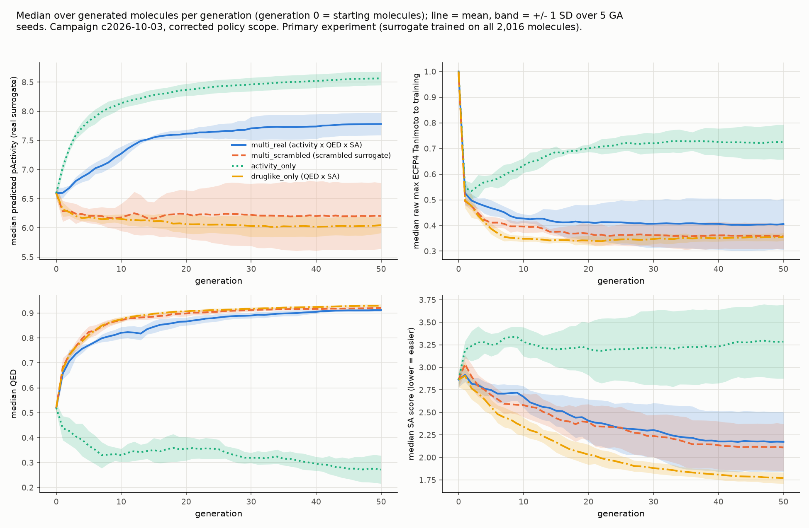

# Does a surrogate-driven molecule optimizer improve the target, or exploit the surrogate?

A methodological case study on human CDK2 (cyclin-dependent kinase 2).

**Question.** When a genetic algorithm (GA) designs molecules against a machine-learned activity model under drug-likeness constraints, does the objective rise because the molecules get better, or because the optimizer finds where the model's extrapolation error is largest?

**What this is not.** It does not show that any generated molecule is active against CDK2, and it did not measure the surrogate's error on generated molecules. It is a study of how optimization curves behave, with the controls needed to interpret them. Problems found in an independent review of the first campaign are tracked in [`docs/known_issues.md`](docs/known_issues.md); most are now fixed in code, and a second campaign repeats the experiment with the fixes.



*Median per generation over 5 GA seeds (band = ±1 SD). Predicted activity rises for the activity-driven arms, but the rise is the surrogate's own output: a GA driven by a label-scrambled model and a drug-likeness-only GA are the controls. More figures with captions and limitations: [`docs/figure_index.md`](docs/figure_index.md).*

## Approach

| Component | Choice |
|---|---|
| Data | ChEMBL CHEMBL301 (human CDK2) IC50 records, cached download of 5,367 rows, curated to 2,016 standardized structures (exact `=` records only, mutant assays removed, median pActivity per structure) |
| Surrogate | ECFP4 (radius 2, 2048 bits) + random forest (300 trees); random, scaffold and primary-document splits, 10 seeds each, with label-scrambled, mean and size-only controls |
| Optimizer | Graph-based GA (population 100, 50 generations, 20-39 heavy atoms). Four arms: `multi_real` (activity × QED × SA), `multi_scrambled` (same, scrambled surrogate), `activity_only`, `druglike_only` (QED × SA). Five seeds per arm |
| Extensions | Held-out surrogates (without 204 top-decile actives; without 9 scaffold families), five scaffold-split surrogates, constrained runs with a hard similarity floor (0.4-0.7) |
| Orthogonal check | AutoDock Vina into PDB 4KD1, native-ligand redocking, PoseBusters (22 checks), hinge-contact distance |
| Preparation policies | `legacy` (candidates scored as edited) vs `corrected` (standardized like the training data, closed-shell only, deduplicated). The comparison bundles three changes; results are reported per policy and never pooled |
| Discipline | Analysis plan frozen before the campaign's runs ([`campaigns/c2026-10-03/plan/`](campaigns/c2026-10-03/plan/)), amendments appended, SHA-256 manifests for every stage output, a ledger of every run, and a leakage and artifact audit |

The plan was written after the project's earlier exploratory work, with those results known, so it is not a plan written before all exploration.

## Project status

| Campaign | State | Design |
|---|---|---|
| `c2026-10-03` | Complete, frozen. Results below | Two preparation policies (`legacy`, `corrected`), 5 GA seeds per arm, one scrambled-label permutation |
| `c2026-11-22` | Prepared, see [`campaigns/c2026-11-22/plan/`](campaigns/c2026-11-22/plan/) | `corrected` policy only, **10 GA seeds**, **one label permutation per seed**, distinct-standardized counting enforced in code, element-wise stereo check on docked poses, repaired H5 estimator, resume that re-checks inputs and code |

The tables below are from `c2026-10-03`.

## Results

Unit of replication is the GA run (n = 5 per arm), so ranges and run counts matter more than p-values. Full claim-by-claim evidence with source tables: [`docs/claims_to_evidence.md`](docs/claims_to_evidence.md).

| Hypothesis | Outcome |
|---|---|
| **Surrogate** | Held-out R² about 0.64 / 0.49 / 0.30 (random / scaffold / paper split); controls near or below zero. Scaffold and paper splits are not series independence or temporal validation |
| **H1** predicted activity rises | Yes for `multi_real` and `activity_only` in all 5 runs, under both policies. This is the surrogate's own prediction |
| **H2** similarity to training falls as prediction rises | In 4 of 5 `multi_real` runs per policy, but the drug-likeness-only arm, which has no activity term, ends at similar similarity, so the drift is not specific to chasing activity |
| **H3** docking transfer | **Not assessed.** The validity gate fixed in the plan (can Vina separate held-out actives from property-matched decoys?) failed in every group. The benchmark is inconclusive, not evidence that Vina has no signal |
| **H4** scrambled-label curve | The scrambled arm rises on the surrogate it follows (rank correlation ≥ 0.9 in 5 of 5 runs), while the real surrogate's prediction of its molecules is not above the baseline. A rising curve alone is therefore no evidence of progress |
| **H5** similarity floor | Exploratory. A floor lowers final predicted activity in at least 4 of 5 seeds only for `activity_only` at some floors. The exchange-rate estimates are **provisional** (known issue 1) |

Other observations: redocking of dinaciclib recovers the crystal pose (RMSD 0.63-0.65 Å over three seeds); most poses pass PoseBusters, which indicates plausible geometry, not binding. The two preparation policies give qualitatively similar results; radical-bearing candidates appear only under `legacy`.

**Counting convention.** Population statistics are computed over saved population rows (raw stored SMILES, every occurrence), one value per run. This is not the standardized-distinct view the plan names as primary (known issue 2). Generation 0 consists of training-set molecules.

## Limitations

Assay heterogeneity (ATP concentration mostly unrecorded; many assays use CDK2/cyclin A while docking uses monomeric CDK2); censored `>` records dropped (31% of raw records), which biases the set toward actives; ECFP4 cannot separate identical fingerprints and smooths over activity cliffs; the GA's edits are chemically naive and QED rewards resemblance to existing drugs; Vina is a rigid-receptor score; decoys are putative inactives; "held-out" actives often have close training siblings; one label permutation; n = 5 runs per arm; nothing validated experimentally. An inconclusive comparison is not evidence of no effect.

## Repository layout

```
src/cdk2moo/     library code: curation, features, splits, surrogate, GA, docking, endpoints, audits
scripts/         numbered pipeline stages (01 fetch ... 13 endpoints) and the campaign runner
tests/           161 unit and integration tests (unittest)
campaigns/       frozen campaign c2026-10-03: inputs, plan, manifests, per-policy results and figures, docking store
docs/            claims_to_evidence, figure_index, known_issues, decisions log, environment snapshot, figures
archive/         pre-campaign results and superseded documents, with checksums and restore instructions
notebooks/       initial target exploration
```

## Getting started

```bash
conda env create -f environment.yml
conda activate cdk2
pip install -e .
python -m unittest discover -s tests        # 161 tests: 158 pass, 3 skipped (last run 2026-11-22)
```

`environment.yml` is a portable, unpinned dependency list. `docs/environment_snapshot_macos-arm64.txt` records the exact versions (macOS arm64, Python 3.11, RDKit 2026.03.1, Vina 1.2.7) behind the saved results.

To repeat the experiment as a new campaign (this takes about 8.5 h of docking on 8 cores; the stages themselves have not been rerun from a fresh clone):

```bash
python scripts/campaign_run.py init   --campaign <new-id>
python scripts/campaign_run.py run    --campaign <new-id> --cores 8
python scripts/campaign_run.py status --campaign <new-id>
```

Do not re-initialise `c2026-10-03` over its existing outputs. The campaign's saved tables predate the fix to the H5 exchange-rate estimator; re-running stage 13 would change only those provisional columns.

## Documentation

| File | Contents |
|---|---|
| [`docs/claims_to_evidence.md`](docs/claims_to_evidence.md) | Each claim with its policy, source table, counting definition and qualification |
| [`docs/figure_index.md`](docs/figure_index.md) | Captions, provenance and limitations of each figure |
| [`docs/known_issues.md`](docs/known_issues.md) | Open and fixed problems, and what may be claimed given them |
| [`docs/decisions.md`](docs/decisions.md) | Append-only log of every judgment call, with alternatives and cost |
| [`campaigns/c2026-10-03/HANDOFF.md`](campaigns/c2026-10-03/HANDOFF.md) | Campaign handoff note, written before the review; where it differs from this README and the known issues, they are current |
